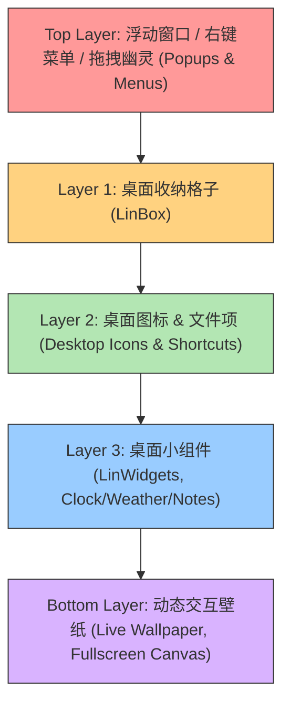
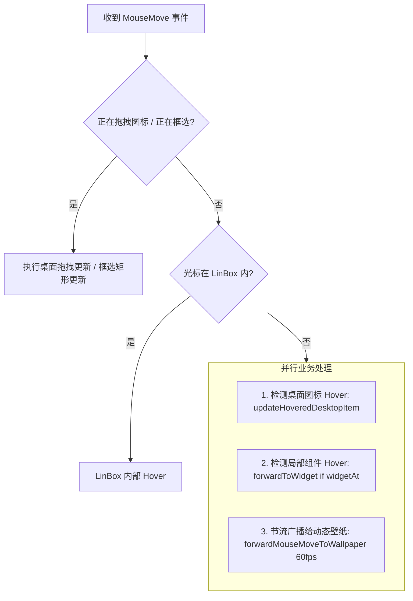
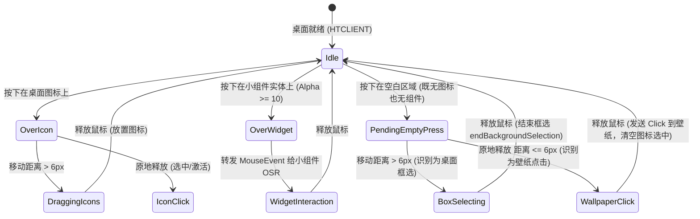

# LinDesk 三层桌面交互体系设计与冲突仲裁规范 (Three-Tier Desktop Interaction Architecture)

## 1. 架构背景与问题诊断 (Background & Conflict Analysis)

在 LinDesk 桌面环境下，存在三种不同层级、不同特性的可视与交互主体：
1. **桌面应用/图标/格子 (Desktop Icons & LinBox)**：原生 Windows/Qt 桌面交互（单选、多选、框选、拖拽排版、双击启动、系统右键菜单、快捷键等）。
2. **桌面小组件 (LinWidgets)**：基于 CEF OSR 离屏渲染的独立小部件（时钟、天气、便签、系统监视器等），具备局部矩形尺寸与局部交互能力。
3. **动态交互壁纸 (Live Wallpaper)**：基于 CEF OSR 离屏渲染的全屏动态背景（WebGL、Canvas、HTML5 粒子效果、交互式网页背景），尺寸覆盖整个桌面视口。

### 1.1 当前实现的核心冲突根因 (Root Cause of Existing Conflicts)

```
+-----------------------------------------------------------------------------------+
| 当前架构缺陷诊断 (Problem Diagnosis)                                              |
+-----------------------------------------------------------------------------------+
| 缺陷 1: 壁纸与组件判定混淆 (HitTest Conflation)                                     |
|   - WidgetManager::widgetAt 与 LinWidgetCanvasWidget::widgetAt 将 wallpaper:xxx   |
|     视为普通 widget 返回，由于壁纸覆盖全屏 (1920x1080) 且像素 Alpha=255，导致桌面    |
|     任何空白区域都被判定为"存在小组件"。                                            |
|   - 结果：桌面空白区域的点击被壁纸全权拦截，无法触发桌面框选、桌面右键菜单和双击。|
+-----------------------------------------------------------------------------------+
| 缺陷 2: WM_NCHITTEST 穿透陷阱 (HTTRANSPARENT Hazard)                             |
|   - ListView.cpp 在开启壁纸交互时，试图在非图标区域返回 HTTRANSPARENT。          |
|   - 结果：由于 CEF 壁纸直接合成在 ListView 的画布中，返回 HTTRANSPARENT 导致    |
|     Windows 将鼠标消息转发到底层 Shell/Progman，ListView 完全收不到鼠标消息。    |
+-----------------------------------------------------------------------------------+
| 缺陷 3: MouseMove 排他消费导致动效阻断 (Exclusive MouseMove)                      |
|   - 目前 forwardMouseEvent 将事件排他性转发（单向消费）。壁纸想要实现粒子跟随鼠标， |
|     但若转发给壁纸，桌面图标就无法产生 Hover 高亮；若优先图标，壁纸则无法流动。  |
+-----------------------------------------------------------------------------------+
| 缺陷 4: 桌面框选 (Drag Selection) 与壁纸单击 (Wallpaper Click) 的二义性            |
|   - 用户在壁纸空白处按下鼠标：如果是想点击壁纸上的按钮，应派发 Click；如果是想拉框选  |
|     桌面图标，应进入桌面框选状态。目前缺乏拖拽阈值（Drag Threshold）仲裁状态机。   |
+-----------------------------------------------------------------------------------+
| 缺陷 5: 键盘与快捷键焦点穿透 (Focus & Shortcut Bleeding)                           |
|   - 组件内输入便签按 Delete 键时，可能同时误删桌面选中的文件图标。                 |
+-----------------------------------------------------------------------------------+
```

---

## 2. 三层交互层级与 Z-Order 规范 (Z-Order Hierarchy)

在视觉合成与事件响应中，确立严格的自上而下的分层模型（Top to Bottom）：



### 层级定义与特性对照表

| 层级 | 实体对象 | 几何范围 | 命中判定机制 | 交互权限与功能 |
| :--- | :--- | :--- | :--- | :--- |
| **Layer 0** | 右键菜单、模态弹窗、重命名框 | 局部浮层 | 绝对优先 | 独占输入，拦截下层所有事件 |
| **Layer 1** | LinBox (桌面格子) | 局部矩形 | `LinBox::rect().contains(localPos)` | 格子折叠、内部滚动、图标组织 |
| **Layer 2** | 桌面应用/文件图标 (`DesktopRootItem`) | 图标+文本包围盒 | `findDesktopStateAt(pos)` | 单击选中、双击打开、拖拽移动、文件右键菜单 |
| **Layer 3** | 桌面小组件 (LinWidgets) | 组件包围盒 | `alpha(pos) >= 10` 像素级透明感知 | 按钮点击、便签打字、滑块拖动；透明区域穿透给底层 |
| **Layer 4** | 动态交互壁纸 (Live Wallpaper) | 桌面全视口 | 空白背景（排除 L1/L2/L3） | 鼠标跟随粒子/流光、交互网页元素单击、滚轮动效 |
| **Background Action** | 桌面多选框选 (Box Selection) | 桌面空白区域 | 空白背景拖拽 (`dist > 6px`) | 桌面多选框选，优先于壁纸拖拽 |

---

## 3. 核心事件路由与仲裁算法设计 (Event Routing & Arbitration)

### 3.1 命中测试分离 (Decoupled Hit-Testing)

核心解耦原则：**`widgetAt(pos)` 必须严格排除壁纸，只返回真正的局部小组件 (LinWidgets)！壁纸由专属的壁纸管线处理。**

```cpp
// 1. widgetAt 仅针对真正的局部小组件
QString WidgetManager::widgetAt(const QPoint& clientPos) const {
    if (!m_enabled || !m_cefOsrEnabled) return QString();
    
    // 委托 Canvas 进行像素级 Alpha 检测，过滤掉透明像素 (Alpha < 10)
    if (m_canvasWidget) {
        QString canvasHit = m_canvasWidget->widgetAt(clientPos);
        // 关键改动：壁纸不算作普通 widgetAt 命中！
        if (!canvasHit.isEmpty() && !canvasHit.startsWith("wallpaper:")) {
            return canvasHit;
        }
    }
    return QString();
}
```

### 3.2 鼠标移动 (MouseMove) 广播管道：动效与响应兼得

为了使动态交互壁纸（如水波、星空、粒子、光标流光）能够实时响应鼠标移动，同时**绝对不阻断**桌面图标和组件的 Hover 感知，采用**非互斥广播（Broadcast Pipeline）**模式：



**节流广播机制 (Throttling)**：
- 壁纸的 `sendMouseMove` 频率限制在 60fps（16ms 间隔），避免高频鼠标移动产生 IPC 洪峰；
- 如果当前壁纸不支持或未开启交互，跳过该广播。

---

### 3.3 鼠标按下与拖拽仲裁状态机 (MousePress / Drag Arbitration State Machine)

解决“壁纸点击”与“桌面空白处框选”的根本方案：**拖拽阈值仲裁 (Drag-Threshold Arbitration)**。



#### 状态机细节说明：
1. **按下 (mousePressEvent)**：
   - 若命中图标：立即进入图标选中/准备拖拽逻辑；
   - 若命中普通小组件：立即转发给该小组件；
   - 若落在空白区域（既非图标亦非小组件）：
     - 记录起始点 `m_pressPos = event->pos()`；
     - 标记 `m_pendingWallpaperClick = true`；
     - **不立即开启框选，亦不立即触发壁纸点击**。
2. **移动 (mouseMoveEvent)**：
   - 若处于 `m_pendingWallpaperClick`：
     - 计算曼哈顿距离 `(pos - m_pressPos).manhattanLength()`；
     - 若 `distance > QApplication::startDragDistance()`（通常 6px）：
       - **判定为用户意图是桌面框选**；
       - `m_pendingWallpaperClick = false`;
       - `m_isSelecting = true`;
       - 触发 `beginBackgroundSelection(m_pressPos)`;
       - 更新框选矩形 `updateBackgroundSelection(pos)`.
3. **释放 (mouseReleaseEvent)**：
   - 若处于 `m_isSelecting`：正常结束桌面框选 `endBackgroundSelection()`;
   - 若处于 `m_pendingWallpaperClick`（移动距离 <= 6px）：
     - **判定为用户意图是点击壁纸**；
     - 向壁纸 OSR 派发完整的 `MousePress` 与 `MouseRelease`；
     - 触发桌面空白处常规清理（清空图标多选高亮，取消重命名等）；
     - `m_pendingWallpaperClick = false`。

---

### 3.4 右键菜单 (ContextMenu) 归属权仲裁

右键菜单是操作系统的最高优先级系统功能。
- **图标区域**：严格弹出 LinDesk 文件/应用右键菜单；
- **LinBox 区域**：弹出 LinBox 专属右键菜单；
- **小组件区域**：如果小组件声明自身右键菜单，转发小组件；否则穿透；
- **空白桌面 / 壁纸区域**：
  - **默认强制弹出 LinDesk 桌面系统右键菜单**（查看、排序、新建、显示设置、LinDesk 桌面设置等）；
  - 严禁 Chromium 默认的网页右键菜单（Back/Forward/Inspect Element）泄露到桌面上；
  - 仅当壁纸特定声明需要处理右键且用户开启“壁纸深度沉浸”时才转发。

---

### 3.5 双击 (DoubleClick) 仲裁

- **双击图标**：打开文件/启动应用；
- **双击组件**：转发给组件；
- **双击空白处/壁纸**：
  - 若用户在设置中启用了“双击桌面隐藏/显示图标 (`doubleClickHideIcons`)”，由 LinDesk 桌面优先响应该动作；
  - 若该选项未启用，将双击事件转发给壁纸 OSR（支持网页双击放大或双击彩蛋）。

---

### 3.6 键盘焦点与快捷键隔离 (Keyboard Focus Isolation)

1. **输入焦点转移**：
   - 当用户点击小组件内的可编辑区域时，小组件获取输入焦点；
   - 当用户点击桌面图标、框选桌面或右键桌面时，调用 `LinWidgetRuntimeBridge::clearWidgetFocus()`，确保桌面取回键盘焦点。
2. **危险快捷键隔离**：
   - 当小组件持有焦点时：全局文件操作快捷键（Delete 删除文件、Ctrl+C 复制文件、F2 重命名文件）被屏蔽或严格限制在小组件内部文本编辑范畴，绝不波及桌面图标！

---

## 4. 实施细分任务表 (Implementation Task Breakdown)

| 阶段 | 模块 | 任务描述 | 涉及文件 | 验收标准 |
| :--- | :--- | :--- | :--- | :--- |
| **Task 1** | **Hit-Test 解耦** | 将 `widgetAt` 与壁纸解耦，确保普通组件、默认页和壁纸的分流明确，透明度检测正常工作 | `WidgetManager.cpp`<br>`LinWidgetCanvasWidget.cpp`<br>`runtime_export.cpp` | `widgetAt` 不再将全屏壁纸作为通用 widget 返回 |
| **Task 2** | **壁纸事件专有通道** | 在 `WidgetManager` 和 `LinWidgetRuntimeBridge` 中添加壁纸专属的事件派发接口 (`forwardMouseMoveToWallpaper`, `forwardMouseClickToWallpaper`, `forwardWheelToWallpaper`) | `WidgetManager.h/.cpp`<br>`runtime_export.h/.cpp` | 壁纸具备清晰独立的输入转发通道，支持 60fps 节流 |
| **Task 3** | **ListView 交互状态机改造** | 在 `ListView.cpp` 中修正 `WM_NCHITTEST`（移除 `HTTRANSPARENT`，统一返回 `HTCLIENT`）；实现按压防抖与拖拽仲裁（`m_pendingWallpaperClick` -> `6px` -> `m_isSelecting` 切换） | `ListView.h`<br>`ListView.cpp` | 空白处框选顺畅；空白处点击能触发壁纸按钮；移动鼠标壁纸粒子流畅流动 |
| **Task 4** | **右键与双击、键盘隔离** | 完善 `contextMenuEvent`、`mouseDoubleClickEvent`、`keyPressEvent`，保证桌面系统功能与快捷键安全 | `ListView.cpp` | 右键空白处稳定弹出桌面菜单，双击隐藏图标正常，组件内打字不误删桌面图标 |
| **Task 5** | **工程编译与单元测试** | 执行 Release 与 Debug 完整构建，运行 CTest 全部测试套件，验证零 Regression | 根目录构建输出 | Release/Debug 编译 0 警告 0 错误，9/9 测试通过 |

---

## 5. 文档审查与风险控制 (Design Review & Verification Checklist)

1. **高 DPI 与多屏支持**：
   - 必须通过 `dpr` 换算本地坐标与物理纹理像素；
   - 转发给 CEF 的坐标必须转换为 CEF OSR 视口内的局部坐标 (`pos - geometry.topLeft()`)。
2. **性能与内存 (Performance)**：
   - MouseMove 节流到 60fps，避免 CEF IPC 饱和；
   - Alpha 检测直接读取当前帧像素缓存，复杂度为 $O(1)$。
3. **退化与容错 (Fallback & Robustness)**：
   - 当未加载 CEF 或壁纸为静态图片时，交互管道自动静默回退到原生桌面行为，零性能损耗。
